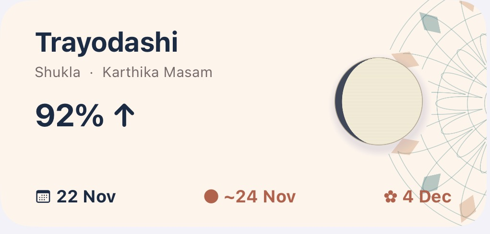
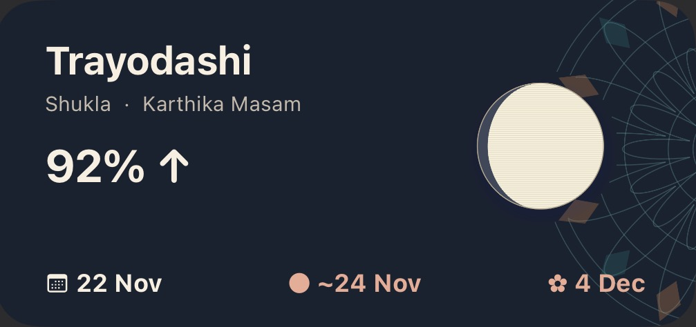
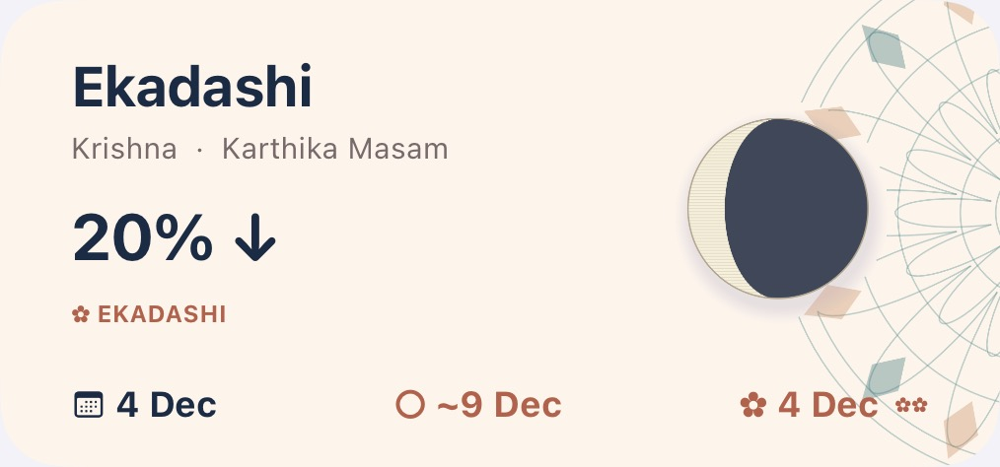
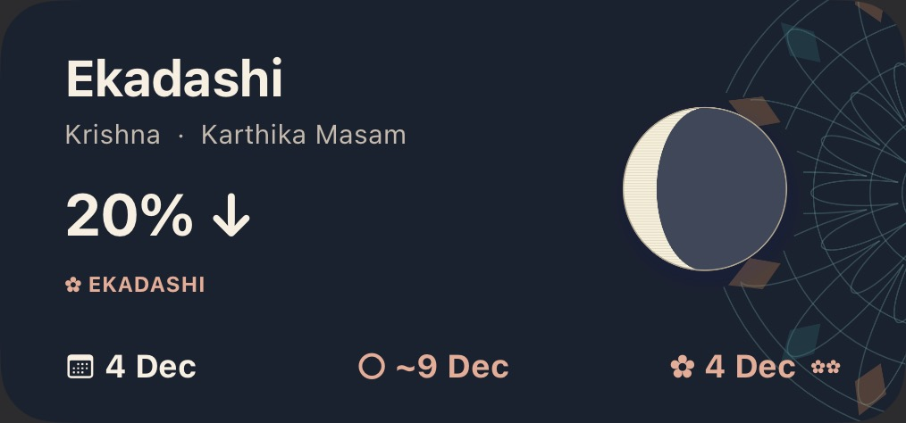

# Moon & Ekadashi for Scriptable

A quiet, offline home-screen widget for Hyderabad. It shows an estimated Moon illustration and illumination, the current estimated tithi in the medium widget, and the next published Ekadashi observance. All dates use Hyderabad's IST, even when the phone is in another time zone.

## Screenshots

These are iPhone captures of the widget. Dates, tithi and Moon phase are examples from the time each capture was taken.

| Everyday · light | Everyday · dark |
|---|---|
|  |  |

| Ekadashi · light | Ekadashi · dark |
|---|---|
|  |  |

## Update your existing widget

1. Open `Moon & Ekadashi.js` and copy **all** its contents to your iPhone.
2. In Scriptable, open your existing **Moon & Ekadashi** script. Select all the old code, paste the new code, and tap **Done**. Keep the same script name.
3. Touch and hold the existing Home Screen widget, tap **Edit Widget**, and check that **Script** is set to `Moon & Ekadashi`.
4. Use a **medium** widget. Leave **Parameter** blank. The widget uses the iPhone’s light or dark appearance automatically.
5. Tap the widget to open the two-month calendar in Scriptable. Tap arrows to move by one month, **Today** to return, and a date for details. A tinted circle marks Ekadashi at sunrise; a dashed circle marks an Ekadashi that falls between sunrises. A small solid dot marks an astronomical full Moon and a hollow dot a new Moon. A date can have more than one marker. Tap or swipe down on the Scriptable sheet to close it.

The widget shows the current estimated tithi as the heading, paksha and Hyderabad Telugu masam below it, the estimated illumination and direction, and a single row with today, the next astronomical lunar event and the next sunrise-qualified Ekadashi. The masam is selected from published civil-day month ranges; it does not switch at an exact moment and is unavailable outside 2026–2027. The calendar icon marks today; ● means the next astronomical full moon; ○ means the next astronomical new moon; ✿ marks the next Ekadashi at sunrise. The tilde (~) marks the approximate astronomical event date. The medium size is required for the intended readability and layout.

Calendar Moon markers and full/new moon dates are the **astronomical moments**, converted to IST; these are not necessarily the same as the Pournami or Amavasya tithi's observance date in a panchangam. Calculations use a low-precision offline model and are approximate.

Run the script directly in Scriptable and choose **Preview widget** to verify the installed code; the menu says **Mandala layout v6**. Choose **Preview Ekadashi** to preview the next sunrise-qualified Ekadashi, or **Open calendar** to open the calendar. The Ekadashi preview uses the next listed date at noon in Hyderabad; if no future date is bundled, it uses the final listed date. Tapping the Home Screen widget opens the calendar directly.

## Appearance and interaction

The calendar and widget follow the iPhone appearance. Widget text and colors are native elements; only the Moon and mandala are drawn as an image. iOS controls the timing of widget refreshes. The calendar has subtle press and entrance animations, disabled if Reduce Motion is enabled. iOS/Scriptable widgets do not animate in place on touch: tapping opens the calendar in Scriptable. The small widget has one tap target.

No account, network connection, or location permission is needed. The location is fixed to Hyderabad. The widget requests a refresh after 30 minutes; iOS controls the actual refresh schedule.

## Sunrise rule and calendar

A day is marked when Ekadashi is present at Hyderabad sunrise. The script uses bundled, checked dates for 2026–2027; it does not calculate sunrise in real time. When a tithi spans two sunrises, both days are marked. When it spans neither sunrise, the calendar displays a dashed-circle note on the published primary date, but that day is not counted as an Ekadashi-at-sunrise day. Select the date for details. This is a personal display rule, not a determination of fasting or parana.

- **2026:** Padmini qualifies on both 26 and 27 May; Yogini falls between sunrises on 10–11 July; Prabodhini qualifies on 21 November rather than the published primary date of 20 November.
- **2027:** Pausha Putrada qualifies on 19 January; Vijaya qualifies on both 3 and 4 March; Kamika falls between sunrises on 29–30 July. Rama on 25 October meets the sunrise rule even though some traditions observe it on 26 October.
- For Kamika and Yogini, the calendar note includes the name and distinguishes it from a sunrise-qualified date. Some traditions choose a fasting date even when the tithi misses sunrise.
- The current Moon illustration, illumination and tithi are calculated with a low-precision astronomical model. They are **estimates** and the current tithi can be wrong near its boundary; the sunrise-date markers do not depend on this estimate. The Moon orientation is illustrative.
- The calendar covers **2026–2027** only and must be updated for later years. The tithi at a time during the day can differ from the tithi at sunrise. Consult your panchangam for authoritative timings and observance.

## Hyderabad sunrise dates in 2027

| Month | Dates with Ekadashi at sunrise |
|---|---|
| January | 3, 19 |
| February | 2, 17 |
| March | 3, 4, 18 |
| April | 2, 17 |
| May | 2, 16 |
| June | 1, 14, 30 |
| July | 14; Kamika on 29–30 is between sunrises and does not qualify |
| August | 12, 28 |
| September | 11, 26 |
| October | 11, 25 |
| November | 10, 24 |
| December | 9, 23 |

The Moon and mandala use the geometry of the approved Mac preview. Native widget text is rendered separately over edge-to-edge transparent artwork; spacing can differ on individual devices. On a sunrise-qualified Ekadashi it adds an Ekadashi label. A few flowers appear along the bottom of the widget on that day. When the calendar is opened on that day, four flowers fall and settle near the bottom; Reduce Motion disables that animation. The Home Screen widget itself remains static between iOS refreshes.

## Sources

- [Hyderabad Telugu month ranges, 2026](https://srinivasapanchangam.com/calendar/2026)
- [Hyderabad Telugu month ranges, 2027](https://srinivasapanchangam.com/calendar/2027)
- [Telugu Calendar: Hyderabad 2026](https://thetelugucalendar.com/ekadashi/2026/hyderabad/)
- [Telugu Calendar: Hyderabad 2027](https://thetelugucalendar.com/ekadashi/2027/hyderabad/)
- [Drik Panchang: Hyderabad Ekadashi dates, 2026](https://www.drikpanchang.com/vrats/ekadashidates.html?geoname-id=1269843&year=2026)
- [Drik Panchang: Hyderabad Telugu festivals, 2027](https://www.drikpanchang.com/telugu/calendar/telugu-calendar.html?geoname-id=1269843&year=2027)
- [Panchvani: Hyderabad sunrise dates, 2026](https://panchvani.com/vrat/ekadashi/2026/hyderabad)
- [Panchvani: Hyderabad sunrise dates, 2027](https://panchvani.com/vrat/ekadashi/2027/hyderabad)
- [Kamika between sunrises, 2027](https://www.mypanchang.com/kamikaekadashi/hyderabad)
- [Scriptable widget documentation](https://docs.scriptable.app/listwidget/)
